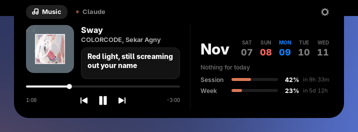
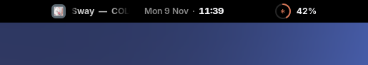
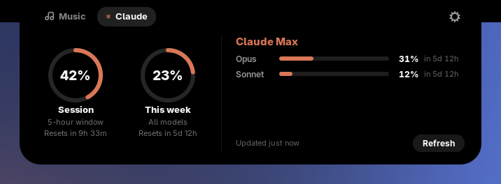
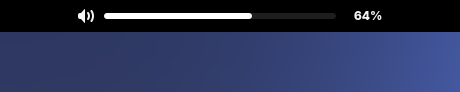

# Ponyx

A notch for the GNOME top bar. It sits in the middle of the panel as a small black island and opens when you hover over it. Inside you get the track that's playing, the week ahead, and how much of your Claude plan you've used.

Supports GNOME Shell 50.

<p align="center">
  
</p>

<sub>Screenshots show <a href="https://open.spotify.com/track/0RGxQocQrEo7hMEaGNSlSg">Sway</a> by COLORCODE and Sekar Agny, with sample usage numbers. The lyric line was fetched live from LRCLIB by the extension; lyrics belong to their rights holders.</sub>

## Features

### The collapsed notch

<p align="center">
  
</p>

- Sits in the center of the top bar. The panel clock moves to the right side to make room (you can turn this off).
- Shows the time and date, using your 12h/24h setting.
- Scrolls the current track's title and artist as a ticker while music plays.
- Shows a small badge with your current Claude session usage. It turns red from 75%.
- Click or hover to open. Scroll on it to change the volume.

### Music

- Works with any player that supports MPRIS: Spotify, Firefox, Chromium, Rhythmbox, mpv, and others.
- Album art, title, artist and album, plus previous, play/pause and next buttons.
- A seek bar with elapsed and remaining time. Drag it to jump around in the track.
- The island picks up a tint from the album art's colors.
- **Lyrics** from [LRCLIB](https://lrclib.net). Time-synced lyrics follow the song line by line. If a track only has plain lyrics, those are shown instead.

### Calendar

- A five-day strip next to the month name: two days back, today (highlighted), two days ahead.
- Your next event for the day, read from the same calendars as GNOME's own calendar (Evolution Data Server, so GNOME Online Accounts calendars show up too).

### Claude usage

<p align="center">
  
</p>

For people on a Claude Pro, Max, Team or Enterprise plan who use [Claude Code](https://claude.com/claude-code).

- Rings for the 5-hour session window and the weekly window across all models.
- Separate weekly bars for Opus and Sonnet when your plan has them.
- Shows when each window resets.
- The Music tab also shows session and weekly bars under the calendar, so you don't have to switch tabs.
- Desktop notifications when a window passes 75% and 90%. The notch badge pulses from 90%.
- Checks every 5 minutes by default (1–60, configurable). There's also a Refresh button.
- Keeps showing the last reading across restarts and backs off when the API rate-limits it.

### Pop-ups in the notch

<p align="center">
  
</p>

Volume, brightness, mic mute, charger plugged/unplugged and audio output changes (for example, plugging in headphones) show up inside the notch instead of GNOME's on-screen display box in the middle of the screen. Other monitors still get the normal GNOME pop-up.

## Install

### From extensions.gnome.org

Once it's published, install it from [extensions.gnome.org](https://extensions.gnome.org) or the Extension Manager app.

### From source

```sh
git clone https://github.com/codehilman/ponyx.git
cd ponyx
./install.sh
```

`install.sh` compiles the settings schema and symlinks the extension into `~/.local/share/gnome-shell/extensions/`. On Wayland, log out and back in once so GNOME Shell picks it up, then:

```sh
gnome-extensions enable ponyx@codehilman
```

### From a release zip

```sh
gnome-extensions install --force ponyx@codehilman.shell-extension.zip
```

Then log out and back in, and enable it as above.

## Settings

Open them with `gnome-extensions prefs ponyx@codehilman` or from the Extensions app.

| Setting | Default | What it does |
| --- | --- | --- |
| Open on hover | On | When off, the island only opens on click |
| Show time and date | On | Clock in the collapsed island |
| Show pop-ups in the island | On | Replaces GNOME's on-screen display for volume, brightness, charger and audio devices |
| Scroll to change volume | On | Scroll anywhere on the island |
| Move clock to the right | On | Moves the panel clock so the island has the center |
| Show lyrics | On | Looks up the playing track on lrclib.net |
| Check every | 5 min | How often to check Claude usage |
| Usage alerts | On | Notifications at 75% and 90%, and the pulsing badge |

## Claude usage setup

Ponyx reads the sign-in that Claude Code saves in `~/.claude/.credentials.json`. Install Claude Code, run `claude` once and log in with your Claude account. That's all.

If the Claude tab says the token expired, run `claude` again to refresh it.

## Privacy

Ponyx only talks to the network for these things:

| Request | Sent to | What's sent | Turn it off |
| --- | --- | --- | --- |
| Claude usage | `api.anthropic.com` | Your Claude Code access token | Don't sign in to Claude Code, and the tab stays empty |
| Lyrics | `lrclib.net` | Title, artist, album and length of the playing track | Settings → Show lyrics |
| Album art | Whatever URL the player reports | Nothing beyond the request itself | — |

Your token is read from disk each time and is never stored or sent anywhere else. Nothing else leaves your computer: no analytics, no tracking.

## Development

```
ponyx@codehilman/
├── extension.js     the island: layout, animation, tabs, OSD pop-ups
├── media.js         MPRIS player watcher and album art cache
├── lyrics.js        LRCLIB client and LRC parser
├── usage.js         Claude usage client, caching and formatting
├── prefs.js         settings window (libadwaita)
├── stylesheet.css
└── schemas/         GSettings schema
```

Wayland can't reload extension code without logging out. To test without touching your session, run a nested shell:

```sh
dbus-run-session -- gnome-shell --devkit --wayland
```

Watch the logs with:

```sh
journalctl -f -o cat /usr/bin/gnome-shell
```

### Building a release

```sh
./pack.sh
```

This writes `dist/ponyx@codehilman.shell-extension.zip`, the file to upload at [extensions.gnome.org/upload](https://extensions.gnome.org/upload/). Before uploading, bump `version-name` in `metadata.json` and add any newly supported GNOME versions to `shell-version`.

## Credits

- **Lyrics** come from [LRCLIB](https://lrclib.net), a free, community-built lyrics database. Thanks to everyone who contributes to it. The lyrics are owned by their respective artists and rights holders. Ponyx fetches them to show while a track plays and never stores or redistributes them.
- **Music info** is read over [MPRIS](https://specifications.freedesktop.org/mpris-spec/latest/), the freedesktop.org standard for media player control.
- **Calendar events** come from GNOME's calendar server and Evolution Data Server.
- **Album art in the screenshots** is the cover of [Sway](https://open.spotify.com/track/0RGxQocQrEo7hMEaGNSlSg) by COLORCODE and Sekar Agny, © its respective owners. It's shown only to illustrate the music player and isn't part of the extension.
- **Icons** are the symbolic icons from your current GNOME icon theme. Ponyx doesn't ship any icons of its own.
- Built on [GNOME Shell](https://gitlab.gnome.org/GNOME/gnome-shell) and its extension APIs.

## License

[GPL-2.0-or-later](LICENSE), the same as GNOME Shell.

Ponyx isn't affiliated with or endorsed by Anthropic, LRCLIB or the GNOME Foundation. Claude and Claude Code are trademarks of Anthropic. GNOME is a trademark of the GNOME Foundation.
